<picture>
  <source media="(prefers-color-scheme: dark)" srcset="./assets/hero-dark.svg">
  
</picture>

I work across the whole AI lifecycle: from exploring the data and framing the problem, through building and evaluating models, to deploying and operating the system with real users. For 4+ years I've done this in domains where a wrong answer is expensive, from US tax filing to medical imaging.

My path started in physics, with a BSc in Medical Physics and an MSc in Information Technology, which still shapes how I work: measure first, then trust.

## From data to production

| Stage | What I do |
|:---|:---|
| **Data science** | Data exploration, statistical analysis, signal and image processing, framing business problems as measurable ones |
| **Modeling** | Deep learning, computer vision, speech, transformer architectures, LLM fine-tuning |
| **AI application design** | Multi-agent architectures, retrieval systems, document understanding, human-in-the-loop flows, agents that act inside real product interfaces |
| **Evaluation** | Validating outputs against ground truth, deterministic checks around probabilistic systems, cost and latency trade-offs |
| **Production** | Backend services and real-time APIs, containerized deployment in cloud and on-premises, asynchronous job processing, multi-tenant isolation, CI/CD and automated testing |

## What I've built

<b>Conversational AI for US tax filing</b>

 
A multi-agent system where an orchestrator delegates to domain specialists, understands each screen and field the user is on, and pauses for human confirmation when it matters. Tax documents are read by a document intelligence pipeline and flow into the forms.

<b>Customer service automation for auto repair shops</b>

 
A multi-tenant WhatsApp agent running on-premises, with fair job scheduling across tenants and model routing with fallback to keep real-time conversations fast and affordable.

<b>Semantic search over service orders</b>

 
A self-hosted hybrid search design that combines keyword and vector retrieval through rank fusion.

<b>Generative AI for Agile automation</b>

 
Generative AI applied to automating Agile workflows in an enterprise environment.

<b>Speech-to-text and RAG assistants</b>

 
Speech-to-text pipelines and assistants that answer from a knowledge base through retrieval.

<b>Computer vision for medical imaging</b>

 
Deep learning for medical images, including research into automated image quality control for mammography equipment.

<b>AI-authored, deterministic test pipelines</b>

 
A CI/CD architecture where coding agents write end-to-end, component and API tests from product specs, while the gate that runs them stays fully deterministic.

<!--STATS:START-->
<!--STATS:END-->

## Let's talk

Building something with AI that has to survive contact with real users? Reach me at [cecchetto.bernardo@gmail.com](mailto:cecchetto.bernardo@gmail.com) · [Hugging Face](https://huggingface.co/bernardocecchetto) · [X](https://twitter.com/Ber_Cecchetto)
